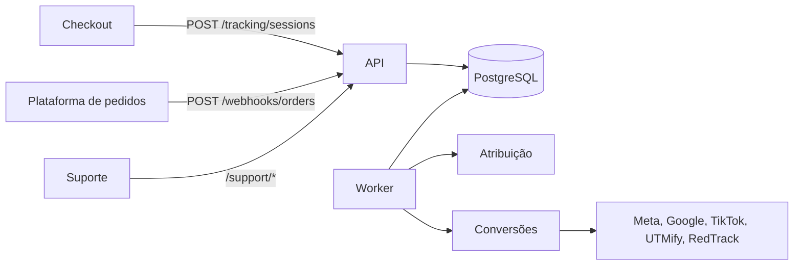

# 01 — Planejamento

## Objetivo

Serviço que captura sessões de navegação, recebe pedidos pagos por webhook, atribui cada venda à sessão correta (com a origem de cada dado auditável) e envia a conversão para Meta, Google, TikTok, UTMify e RedTrack, além de oferecer um endpoint de suporte para diagnóstico.

**Stack:** Node.js 24, TypeScript, Express 5, Prisma 7, PostgreSQL 17, Docker Compose, fila em tabela do PostgreSQL, Vitest.

## Requisitos do documento e onde estão atendidos

| Requisito | Onde |
|---|---|
| Registrar a sessão, normalizar identificadores, `customFields` como única fonte de campanha | `src/modules/tracking/` |
| Webhook com resposta rápida e processamento assíncrono | `src/modules/orders/`, `src/worker.ts` |
| Mesmo `eventId` não duplica pedido, comissão nem conversão | Constraints únicas no banco e lock por pedido. Não há cálculo de comissão (o documento não define regra); o afiliado da venda é gravado uma única vez por pedido, no snapshot |
| Relacionar a venda à sessão, ou marcá-la como não atribuída | `src/modules/attribution/resolve.ts` |
| Valores em centavos e payload original preservado | `Order.amountMinor`, `WebhookEvent.payload` |
| Não inventar campanha sem `customFields` | Origem `NONE` no snapshot |
| Estratégia de atribuição auditável | Níveis 1 a 5, origem de cada dado e rastro da decisão |
| Cinco adaptadores independentes | `src/modules/conversions/providers/` (simulados) |
| Regras de envio: sem duplicar, falha isolada, retry controlado, sem loop, reprocesso seguro, tentativa registrada | `src/modules/conversions/{create,deliver}.ts` |
| Endpoint de suporte | `src/modules/support/` |

## Diferenças em relação ao documento (aprovadas)

| Item | Motivo |
|---|---|
| Bloco opcional `identifiers` no webhook | Viabiliza os níveis 2 e 3 da atribuição (ADR-002) |
| `POST /support/orders/:orderId/reprocess` | Forma de reprocessar a venda, exigida pelo caso de teste 6 (ADR-010) |
| `/support/*` protegido por `X-API-Key` | O suporte expõe dados de clientes (ADR-024) |
| Sem cálculo de comissão | O documento não pede nem define a regra. O `affiliateCode` é registrado com origem e evidência (ADR-006) |
| Provedores simulados | O documento não fornece credenciais (ADR-036) |

## Arquitetura

Monólito modular com dois processos do mesmo código: **API** (recebe e grava) e **worker** (processa a fila).

| Módulo | Responsabilidade |
|---|---|
| `tracking` | Sessões: validação, normalização, upsert sem sobrescrever evidência |
| `orders` | Webhook, idempotência, criação do pedido |
| `attribution` | Descobre sessão, campanha e origem. Não conhece provedores |
| `conversions` | Envia aos provedores com retry e registra as tentativas. Não conhece as regras de atribuição |
| `support` | Diagnóstico e reprocessamento |

O funcionamento detalhado está em [03-FLUXO-DO-SISTEMA.md](03-FLUXO-DO-SISTEMA.md).

## Modelagem

| Tabela | Conteúdo | Unicidade |
|---|---|---|
| `TrackingSession` | Sessão, identificadores, `customFields`, cliente | `sessionId` |
| `TrackingSessionRevision` | Histórico de cada envio de sessão e dos conflitos | — |
| `WebhookEvent` | Todo webhook recebido, com o payload original | `eventId` |
| `Order` | Pedido (valor em centavos, moeda) | `orderId` |
| `AttributionSnapshot` | Resultado imutável da atribuição | Um por pedido |
| `Conversion` | Uma por pedido e provedor, com o evento congelado | (pedido, provedor) |
| `DeliveryAttempt` | Cada tentativa: status, HTTP, erro, datas, request enviado | (conversão, número) |
| `Job` | Fila | `dedupKey` |
| `ReprocessRequest` | Quem pediu reprocessamento, quando e o que foi feito | — |

## Endpoints

| Rota | Autenticação | Respostas principais |
|---|---|---|
| `GET /health` | — | `200`, ou `503` sem banco |
| `POST /tracking/sessions` | — | `201` criou, `200` atualizou, `400` |
| `POST /webhooks/orders` | — | `202` (`accepted` ou `duplicate`), `400` |
| `GET /support/orders/:orderId/tracking` | `X-API-Key` | `200`, `401`, `404` |
| `POST /support/orders/:orderId/reprocess` | `X-API-Key` | `202`, `400`, `401`, `404` |

Exemplos em `postman/tracking-hub.postman_collection.json`.

## Casos obrigatórios de teste

| # | Caso | Teste |
|---|---|---|
| 1 | Venda relacionada por `sessionId` | `tests/integration/attribution.test.ts` |
| 2 | Venda sem tracking como não atribuída | `attribution.test.ts`, `conversions.test.ts` |
| 3 | Evento repetido sem duplicar | `webhooks-ingest.test.ts`, `orders-process.test.ts` |
| 4 | Webhook sem campanha recupera `customFields` da sessão | `attribution.test.ts` |
| 5 | Falha temporária com retry e isolada entre provedores | `conversions.test.ts` |
| 6 | Reprocessamento sem repetir entregas | `conversions.test.ts`, `support-reprocess.test.ts` |
| 7 | Pixel capturado, webhook sem click ID | `attribution.test.ts` |
| 8 | Duas sessões do mesmo cliente sem atribuição incorreta | `attribution.test.ts` |

## Entregáveis

Código e migrations (`src/`, `prisma/`), `docker-compose.yml` e `.env.example`, testes (`tests/`), README e `docs/`, coleção do Postman (`postman/`).

O que não está pronto para produção: [06-LIMITACOES-CONHECIDAS.md](06-LIMITACOES-CONHECIDAS.md).
