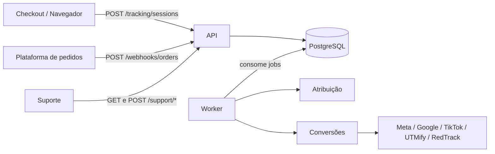
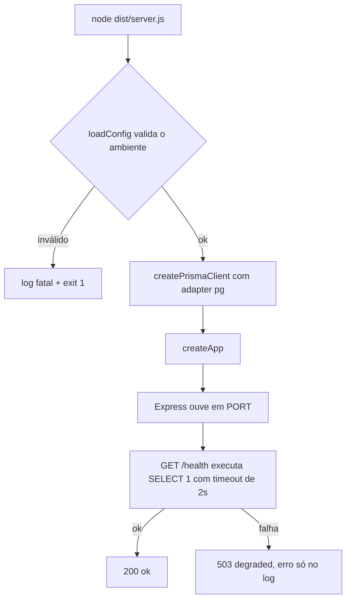
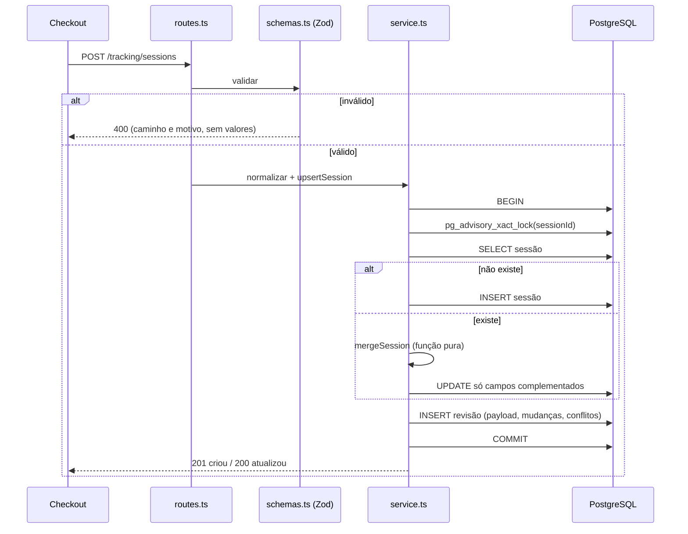
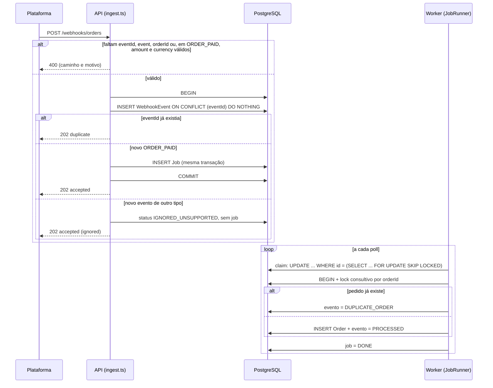
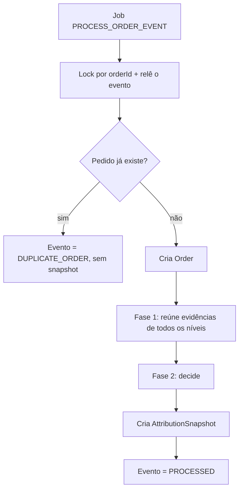
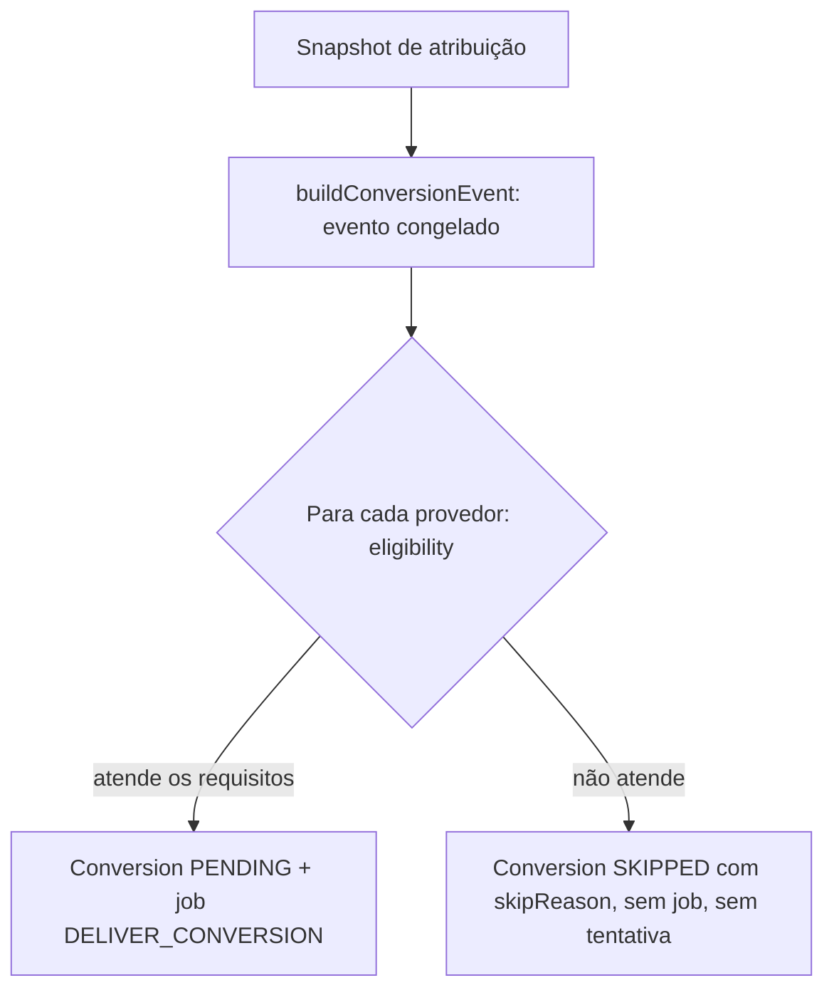
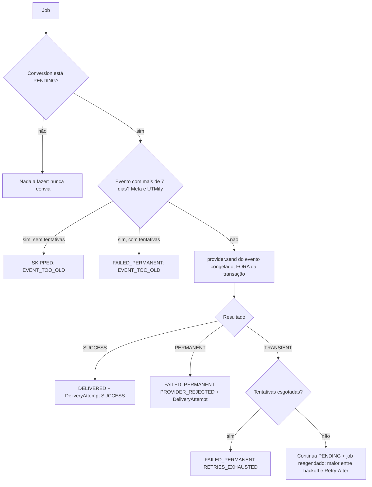
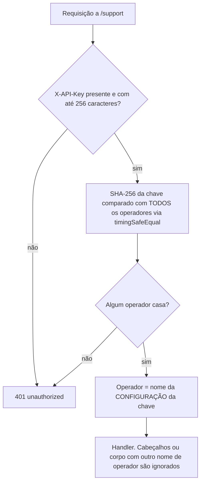
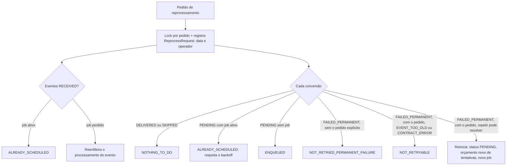
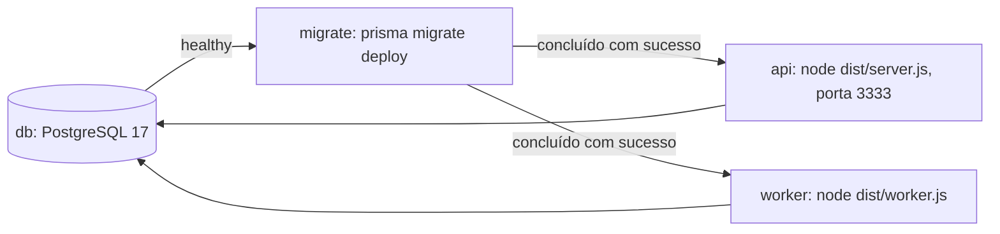

# 03 — Fluxo do Sistema

## Arquitetura geral

## Responsabilidade de cada parte

| Parte | Responsabilidade | Estado |
|---|---|---|
| API (`server.ts`, `app.ts`) | Recebe requisições, valida, grava e enfileira | Todas as rotas implementadas (Etapas 1 a 6) |
| Worker (`worker.ts`) | Consome a fila e executa atribuição e conversões | Implementado (Etapas 3 a 5) |
| `attribution` | Descobre sessão, campanha e origem. Não conhece provedores | Implementado (Etapa 4) |
| `conversions` | Entrega ao provedor com retry. Não conhece regras de atribuição | Implementado (Etapa 5) |
| `support` | Diagnóstico e reprocessamento | Implementado (Etapa 6) |

## Infraestrutura local (implementada)

- PostgreSQL 17 via Docker Compose, com dois bancos: `tracking_hub` (aplicação) e `tracking_hub_test` (testes de integração, criado por `docker/init-test-db.sql`).
- A execução completa (banco, migrations, API e worker) está descrita na seção "Execução com Docker Compose", no fim deste documento.

## Etapa 1 (implementada)

**Inicialização da API:** `server.ts` carrega a configuração (`loadConfig`). Se algo estiver inválido, registra o motivo (sem valores) e encerra com erro. Em seguida cria o cliente do banco, monta o app e começa a ouvir.

**Tratamento de erros:** rota inexistente responde `404 {"error":"not_found"}`. JSON malformado responde `400 {"error":"invalid_json"}`. Erro inesperado responde `500 {"error":"internal_error"}` e o detalhe só vai para o log.

**Persistência:** 9 tabelas conforme o ADR-027. A idempotência é garantida por constraints únicas do PostgreSQL: `sessionId`, `eventId`, `orderId`, `(orderId, provider)`, `dedupKey` de conversão e de job, um snapshot por pedido e `(conversionId, attemptNumber)`.

**Logs:** o Pino oculta e-mail, telefone, chaves de API e cabeçalhos de autenticação (ADR-019).

## Etapa 2 (implementada): `POST /tracking/sessions`

**Regras do merge (`merge.ts`):**

| Campo | Regra |
|---|---|
| Identificadores, e-mail, telefone | Vazio e recebido: complementa. Preenchido e diferente: mantém o original e registra conflito. Nulo recebido nunca apaga. |
| `customFields` | Objeto atômico. Preenchido uma vez. Outro objeto diferente vira conflito, sem merge por chave. `{}` conta como ausente. |
| `pageUrl` | A primeira é preservada. As demais ficam só no histórico. |

**Tratamento de erros:** `400 validation_error` (detalhes com caminho e motivo, sem valores), e-mail ou telefone inválidos viram `warnings` sem perder a sessão.

**Segurança:** a resposta só informa os nomes dos campos em conflito, nunca os valores, porque o endpoint é público. O lock consultivo por `sessionId` evita atualizações perdidas em requisições simultâneas.

## Etapa 3 (implementada): webhook, fila e pedido

**Ciclo de vida do job:** `PENDING` -> (claim) `RUNNING` -> `DONE`. Se o handler falha: volta a `PENDING` com `runAt` no futuro (backoff exponencial com jitter) até `JOB_MAX_ATTEMPTS`, e depois `FAILED`. Erro permanente ou tipo sem handler vai direto a `FAILED`. `RUNNING` há mais de `JOB_LOCK_TIMEOUT_MS` é considerado abandonado e é retomado.

**Status do evento:** `RECEIVED` (aguardando), `PROCESSED`, `IGNORED_UNSUPPORTED`, `DUPLICATE_ORDER`, `FAILED` (reservado).

**Tratamento de erros:** `400 validation_error` sem valores. Campos opcionais malformados viram `warnings` e a venda é aceita. Falha no worker nunca perde o evento: ele já está gravado com o payload original.

**Garantias de idempotência (de fora para dentro):** `eventId` único no banco, `dedupKey` única do job, lock consultivo por `orderId` no worker e `orderId` único no banco.

## Etapa 4 (implementada): atribuição

O handler do worker agora cria o pedido **e** o snapshot de atribuição na mesma transação.

**Níveis (fase 2, em ordem):**

| Nível | Evidência | Regra |
|---|---|---|
| 1 | `sessionId` do webhook existe | Vence sempre que existir |
| 2 | `utmifyId`, `redtrackClickId` | Exatamente 1 sessão distinta |
| 3 | `fbclid`, `fbc`, `gclid`, `gbraid`, `wbraid`, `ttclid` (nunca `fbp`/`ttp`) | Exatamente 1 sessão distinta |
| 4 | E-mail do cliente, `firstSeenAt` em `[receivedAt − 24h, receivedAt]` | Exatamente 1 sessão |
| 5 | Nenhuma evidência utilizável | Não atribuída |

Em cada nível: nenhuma sessão, passa para o seguinte. Uma sessão, atribui. **Mais de uma, não atribui e para** (sem tentar o nível seguinte).

**O que o snapshot guarda:** resultado, nível e método, sessão, `customFields` com origem (`WEBHOOK`, `SESSION` ou `NONE`), identificadores efetivos com origem por campo, `affiliateCode` com origem e nível de evidência, alertas e o rastro da decisão.

**Origem de cada dado:**

| Dado | Quando o valor vem do webhook | Quando vem da sessão |
|---|---|---|
| `customFields` | Webhook tem objeto não vazio (inteiro, sem mesclar) | Webhook sem objeto e há sessão atribuída |
| Identificadores | Não há sessão atribuída | Há sessão atribuída (os do webhook só servem para casar e detectar conflito) |
| `affiliateCode` | Vem de dentro do `customFields` usado, e herda a origem dele | idem |

**Alertas:** `ATTRIBUTION_CONFLICT` (outra sessão em outro nível, identificador ou e-mail divergente do da sessão vencedora, sempre mantendo a vencedora) e `CUSTOM_FIELDS_DIVERGENCE`.

**Motivos de não atribuição:** `NO_EVIDENCE`, `NO_MATCHING_SESSION`, `AMBIGUOUS_PLATFORM_IDENTIFIER`, `AMBIGUOUS_CLICK_ID`, `AMBIGUOUS_CUSTOMER_WINDOW`.

**Imutabilidade:** o snapshot é único por pedido (constraint) e nunca é recalculado. Reprocessar o job não o altera, e uma sessão que chega depois do pedido não o muda (limitação conhecida, ADR-023).

**Tempo:** a janela usa o `receivedAt` do evento, e não o horário em que o worker processa. Processar dias depois dá o mesmo resultado.

## Etapa 5 (implementada): conversões

**Criação (no handler do pedido, na mesma transação):** depois do snapshot, monta-se **um** `ConversionEvent` congelado e cria-se **uma** `Conversion` por provedor.

**Entrega (job `DELIVER_CONVERSION`, um por conversão):**

**Estados da conversão:** `PENDING` -> `DELIVERED`, `FAILED_PERMANENT` ou `SKIPPED`. Só `PENDING` é enviável. Os outros são finais (o reprocessamento de falhas permanentes é um pedido explícito da Etapa 6).

**Classificação do resultado:**

| Resultado | Tratamento |
|---|---|
| 2xx | Sucesso |
| Rede, timeout, 408, 425, 429, 5xx | Transitório: retry com backoff exponencial e jitter, respeitando `Retry-After` |
| Demais 4xx, inclusive 401 e 403 | Permanente |
| TikTok: HTTP 200 com `code` diferente de 0 | Permanente (suposição) |
| Bug inesperado no adaptador | Transitório (`UNEXPECTED_ADAPTER_ERROR`), limitado por `CONVERSION_MAX_ATTEMPTS` |
| `ContractError` | `FAILED_PERMANENT` sem tentativa |

**Por que o payload não muda entre tentativas:** o evento é congelado em `Conversion.eventSnapshot`. Cada tentativa reconstrói o request a partir dele, então novos dados da sessão não alteram o que é reenviado.

**Auditoria por tentativa (`DeliveryAttempt`):** número, status, HTTP, resposta, erro, início e fim, e o request efetivamente enviado (método, URL e corpo, **sem cabeçalhos nem credenciais**).

**Isolamento:** um job por conversão, e cada adaptador com seu transporte. Falha, lentidão ou bug em um provedor não afeta os outros.

**Eligibilidade por provedor (identificadores obrigatórios):**

| Provedor | Obrigatório | Outras regras |
|---|---|---|
| Meta | `fbc` ou `fbp` | `pageUrl`, evento com no máximo 7 dias |
| Google | `gclid`, `gbraid` ou `wbraid` | Sem limite de idade |
| TikTok | `ttclid` ou `ttp` | Sem limite de idade |
| UTMify | E-mail do cliente, e `utmifyId` ou `customFields` de campanha | Evento com no máximo 7 dias |
| RedTrack | `redtrackClickId` | Sem limite de idade |

**Origem dos dados pessoais do cliente:** o e-mail vem do webhook (ou da sessão atribuída, sem conflito). O telefone só vem da sessão atribuída, sem conflito. Havendo `ATTRIBUTION_CONFLICT`, nenhum dado pessoal da sessão é usado.

## Etapa 6 (implementada): suporte

**Autenticação (`/support/*`):**

**`GET /support/orders/:orderId/tracking`:** reúne em uma resposta o que o suporte precisa para responder "qual valor foi associado à venda, de onde ele veio e exatamente o que foi enviado".

| Bloco | Conteúdo |
|---|---|
| `order` | Valor (centavos e decimal), moeda, instante da recepção, e-mail **mascarado** |
| `events` | Eventos do pedido e o estado de cada um, com explicação |
| `attribution` | Resultado, nível, explicação, alertas explicados, rastro por nível, sessão e conflitos da sessão |
| `trackingData` | `customFields` e identificadores **com a origem** (`WEBHOOK` ou `SESSION`), afiliado com nível de evidência e se vai aos provedores |
| `conversions` | Por provedor: status, explicação, próxima tentativa, identificadores usados (valor e origem), request enviado e tentativas (HTTP, erro, resposta) |
| `reprocessRequests` | Quem pediu, quando, com qual opção e o que foi feito |

Todo o JSON passa pela máscara de dados pessoais. Hashes SHA-256 são preservados (são a prova do que foi enviado). O payload bruto do webhook e o evento congelado nunca saem.

**`POST /support/orders/:orderId/reprocess`:**

**Orçamento de tentativas:** `attemptNumber` só cresce (é único por conversão e preserva o histórico). O limite conta `attemptCount − attemptBudgetBase`, e o reinício define a base como o `attemptCount` atual.

**Por que o reprocessamento não muda nada do que já foi decidido:** o snapshot de atribuição e o `ConversionEvent` são imutáveis. Só o status das conversões e os jobs de entrega mudam.

## Execução com Docker Compose (Etapa 7)

- **Uma imagem** (`tracking-hub:local`) para API e worker, construída em estágios: as dependências de desenvolvimento ficam fora do runtime, que roda como o usuário `node`.
- **`migrate`** usa o estágio de build (que tem a CLI do Prisma), aplica as migrations e termina. API e worker só sobem depois que ele conclui com sucesso.
- A **API** tem healthcheck em `/health`. O **worker** não expõe porta.
- A configuração vem do `.env`. A URL do banco é sobrescrita no Compose para apontar ao serviço `db`.

## Contrato (Etapa 7)

A coleção do Postman (`postman/`) é o contrato entregue. Um teste automatizado confere que ela cobre todas as rotas do código e executa cada requisição dela contra a API real, verificando o status esperado. Se o código ganhar uma rota nova ou a coleção divergir, o teste falha.
